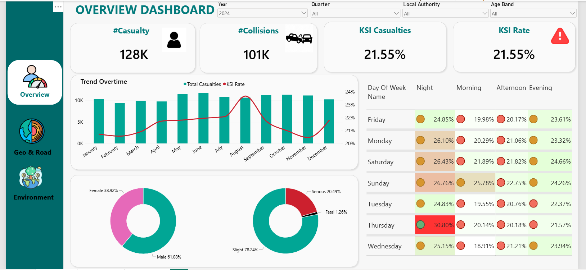
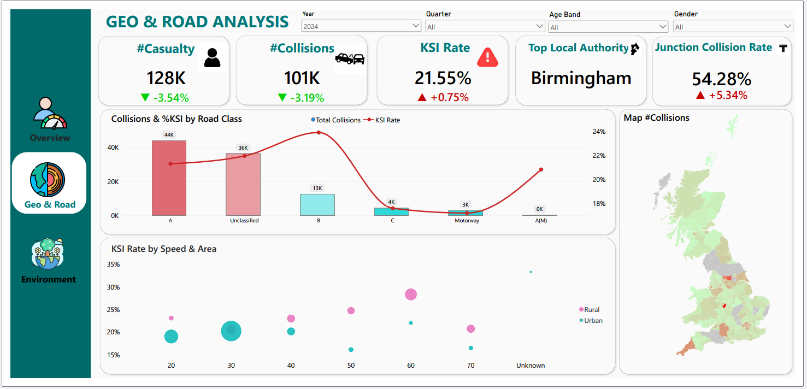
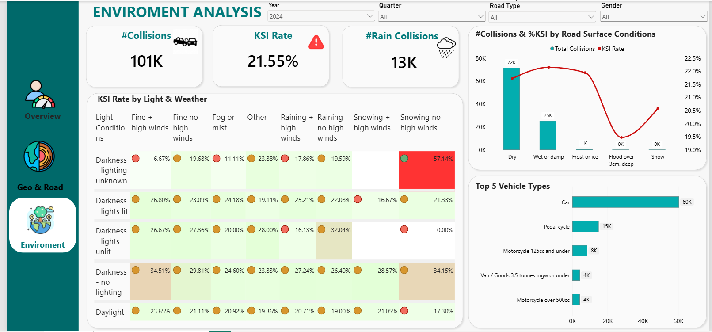
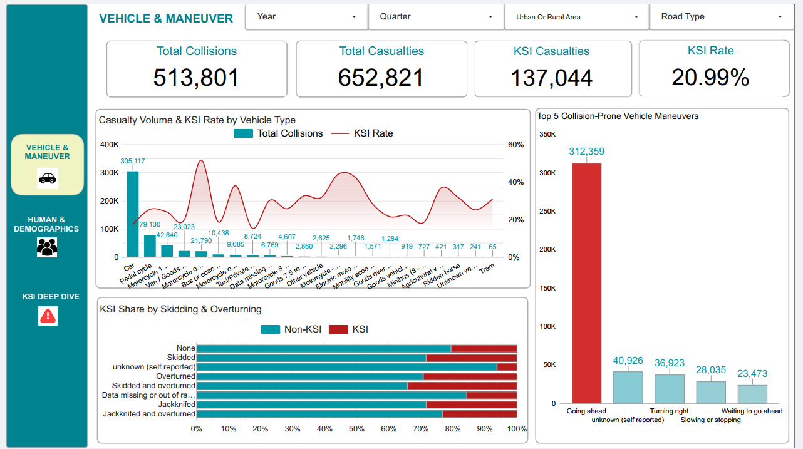
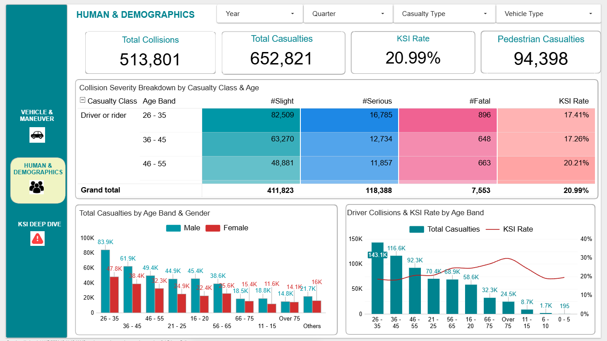
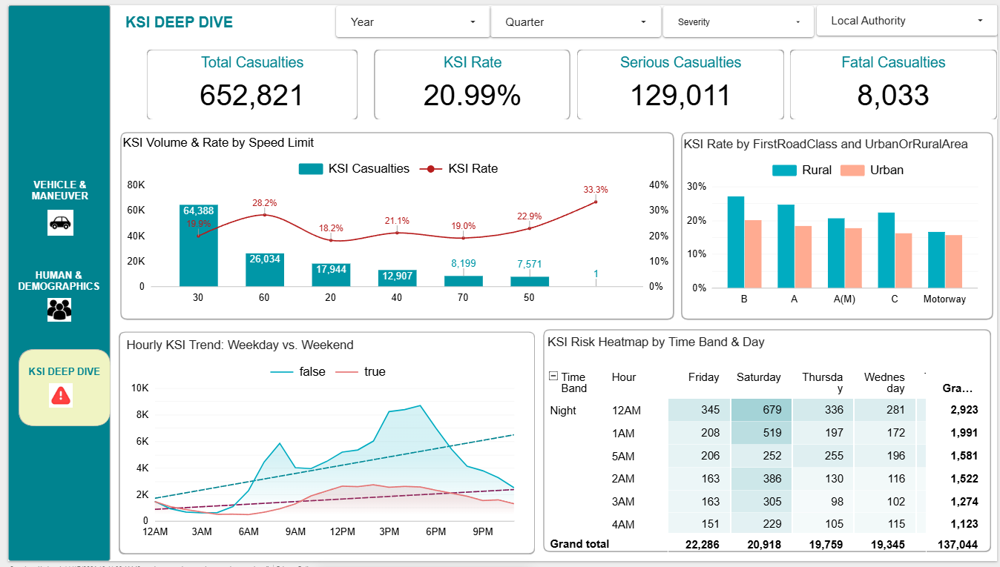

# 🚦 Great Britain Road Safety Data Warehouse & BI Analytics (2021–2025)

[](#)
[](#)
[](#)
[](#)
[](#)

An end-to-end **Data Warehousing & Business Intelligence** solution analyzing police-reported road traffic collisions and casualties across Great Britain from **2021 to 2025**. Built to uncover high-risk temporal windows, geographic hotspots, road infrastructures, environmental factors, and demographic/vehicle profiles driving **KSI (Killed or Seriously Injured)** casualties.

---

## 🎯 Business Problem & Data Challenges

### 1. Business Objective
Address **15 core analytical questions** across 6 analytical dimensions (*Time, Geography, Road & Junction, Environment, Casualty Demographics, Vehicle & Driver*) to move beyond raw collision volume and pinpoint what truly drives fatal and serious road injuries.

### 2. Raw Data Challenges & Engineering Solutions

| Challenge Identified in Profiling | Engineering Solution Implemented |
| :--- | :--- |
| **Unmapped ONS District Codes** (`E07000246`, `E08000038`, `E08000039` missing from official Data Guide) | Enriched `local_authority_region_lookup.csv` with official ONS mappings — achieving **100% lookup coverage (370 distinct districts)** with zero unmapped records. |
| **Encoded Sentinel & Missing Values** (`-1`, `9`, `97`, `98`, `99` across categorical fields; `53` null coordinates) | Preserved valid partial-information codes (`97`, `98`), standardized `-1` in `speed_limit` (`3` rows) and coordinates (`53` rows) to `NULL`, and mapped all categorical codes to human-readable labels. |
| **Grain Mismatch & Double Counting** (`1 Collision` $\rightarrow$ `N Vehicles` $\rightarrow$ `M Casualties`) | Modeled `FactCasualty` at the **1 row = 1 casualty** grain (`652,821` rows) and enforced `DISTINCTCOUNT(CollisionIndex)` (`513,801` collisions) to prevent metric inflation. |
| **Schema Evolution (2021–2025)** (New maneuver code `20` introduced in 2024; specification shifts) | Retained year-accurate categorical mappings without retroactive distortion to preserve longitudinal integrity. |

---

## 🏗️ Architecture & Tech Stack

```text
Raw CSVs (2021–2025) ──► Python Profiling ──► SSIS ETL Pipeline ──► SQL Server DWH (Star Schema) ──► SSAS OLAP Cube ──► Power BI & Looker Studio
```

* **Data Profiling:** Python (Jupyter Notebooks) for schema validation, key integrity, and dimension cardinality estimation.
* **ETL Orchestration (SSIS):** Master package (`00_Master.dtsx`) coordinating 5 sequential packages from reference/raw ingestion to staging, dimension lookups, and fact loading.
* **Data Warehouse (SQL Server):** Star Schema centered on `FactCasualty` connected to 11 conformed dimensions (`DimDate`, `DimTime`, `DimLocation`, `DimRoad`, `DimJunction`, `DimEnvironment`, `DimVehicle`, `DimDriver`, `DimCasualty`, `DimCollisionSeverity`, `DimCasualtySeverity`).
* **OLAP Cube (SSAS):** Multidimensional cube featuring custom hierarchies (`Year → Quarter → Month → FullDate`, `TimeBand → Hour → FullTime`), deterministic sorting, and MDX analytical queries.
* **BI & Visualization:** 6 interactive dashboards (3 in Power BI + 3 in Looker Studio) sharing a unified `#0E6666` design system.

---

## 📊 Key Findings & Real-World Metrics (2021–2025)

### 📌 Executive Baseline (5-Year Total)
* **Total Collisions:** `513,801` | **Total Casualties:** `652,821`
* **Severity Breakdown:** `411,823` Slight (`78.24%` in 2024) | `129,011` Serious (`20.49%` in 2024) | `8,033` Fatal (`1.26%` in 2024)
* **Overall KSI Rate:** `20.99%` (`137,044` KSI casualties across 5 years; `21.55%` in 2024)

### 🔍 Actionable Insights Across 6 Analytical Lenses
* **Speed & Rural Danger:** While 30 mph urban zones account for the highest volume of KSI casualties (`64,388`), KSI Rate surges with speed and rural roads — peaking at `28.2%` on 60 mph roads. Across every road class (A, B, C, Motorway), Rural roads consistently exceed Urban roads in KSI Rate (e.g., `27%` vs. `20%` on Class B roads).
* **Temporal Risk Windows:** Daylight afternoon rush hours (3 PM – 6 PM) record the highest casualty volume, whereas late-night hours (12 AM – 4 AM) carry the highest KSI severity — reaching `30.80%` KSI Rate on Thursday nights and peaking on Saturday early mornings (`679` KSI casualties at 12 AM).
* **Vulnerable Road Users:** Pedestrians account for `94,398` casualties (`14.46%` of all casualties). Drivers/riders aged 26–35 represent the largest casualty cohort (`83.9K` Male, `47.8K` Female), while drivers aged Over 75 exhibit the highest KSI Rate among all driver age groups.
* **Vehicle & Loss-of-Control Physics:** Passenger cars generate the most collisions (`184,805` in vehicle-level view), yet Motorcycles experience KSI Rates exceeding `45%–55%`. Vehicles experiencing both skidding and overturning suffer a `~34%` KSI share, significantly higher than normal driving (`~23%`).
* **Infrastructure & Environment:** `54.28%` of collisions occur at junctions, with Birmingham ranking #1 in collision volume (2024). While `72K` collisions (2024) happen on dry roads, unlit darkness elevates KSI Rates to `32.04%–34.51%` even in moderate weather.

---

## 🖼️ Dashboard Showcase

### Part 1: Power BI (Time, Geography, Infrastructure & Environment)
| 1. Executive Overview | 2. Geo & Road Analysis | 3. Environment Analysis |
| :---: | :---: | :---: |
|  |  |  |

### Part 2: Looker Studio (Vehicle Physics, Demographics & KSI Deep-Dive)
| 4. Vehicle & Maneuver | 5. Human & Demographics | 6. KSI Deep-Dive |
| :---: | :---: | :---: |
|  |  |  |

---

## 📂 Repository Structure

```text
D:\OLAP
├── Data/
│   ├── Raw/                  # Police-reported CSVs (2021–2025: Collisions, Vehicles, Casualties)
│   ├── Reference/            # Official Data Guide & enriched ONS Local Authority lookup
│   ├── Profiling/            # Jupyter notebooks for data quality & cardinality profiling
│   └── Processed/            # Cleaned datasets post-transformation
├── SQL/
│   ├── 01_create_database.sql
│   ├── 02_create_schemas.sql
│   ├── 03_create_staging_tables.sql
│   ├── 04_create_dimensions.sql
│   ├── 05_create_fact_casualty.sql
│   ├── 06_create_constraints_and_indexes.sql
│   └── 07_profile_dimensional_model.sql
├── SSIS/RoadSafetySSIS/      # Master & modular ETL packages (00_Master.dtsx → 05_Load_FactCasualty.dtsx)
├── SSAS/
│   ├── RoadSafetySSAS/       # 11 Dimensions, DSV, Cube, Partitions & Hierarchies
│   ├── PivotExcel/           # OLAP Cube validation workbook
│   └── MDX_Queries.mdx       # Analytical MDX queries
└── Docs/                     # Requirements, profiling reports, transformation rules & Star Schema ERD
```

---

## 🚀 How to Reproduce

1. **Database Setup:** Execute scripts `01` through `06` in `SQL/` on SQL Server to initialize `RoadSafetyDWH`, staging tables, dimensions, and `FactCasualty`.
2. **ETL Execution:** Open `SSIS/RoadSafetySSIS/RoadSafetySSIS.slnx` in Visual Studio (SSDT), update `CM_RoadSafetyDWH.conmgr` to your local SQL Server instance, and run `00_Master.dtsx`.
3. **OLAP Deployment:** Open `SSAS/RoadSafetySSAS/RoadSafetySSAS.slnx`, deploy the cube to Analysis Services, and run `07_profile_dimensional_model.sql` or `MDX_Queries.mdx` to verify row counts and measures.